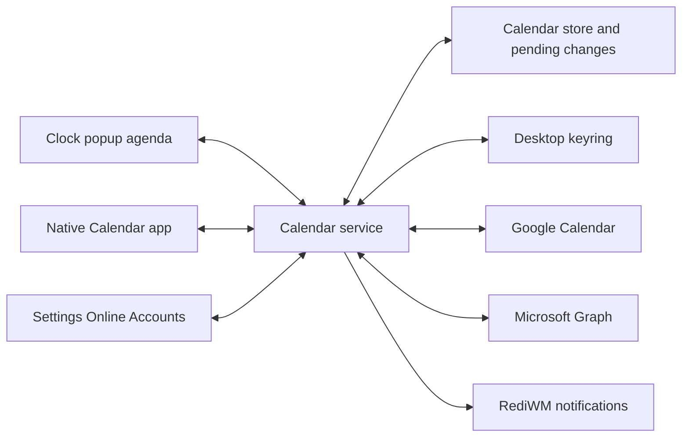

# Calendar integration plan

Status: draft, 2026-10-25. The first release must support **Google Calendar
and Outlook/Microsoft 365 together**, including personal Microsoft accounts
and work or school accounts. CalDAV follows after those providers.

Build a native Calendar application, an agenda in the taskbar clock popup,
and a separate service for storage, synchronization and reminders. Use
[KOrganizer](https://apps.kde.org/korganizer/) as the feature reference:
multiple calendars, event editing, recurrence, reminders, invitations,
tasks and calendar-file interoperability. Deliver this in increments with
explicit completion criteria.

## Current foundation

[`src/calendar.zig`](../../src/calendar.zig) currently provides a month grid,
today highlighting, month navigation, locale/week-start handling and taskbar
placement. It has no event model, selected-day agenda, storage, accounts,
editing or reminders. Preserve its existing behavior and
[`tests/calendar_popup.py`](../../tests/calendar_popup.py) coverage.

RediWM already has native Wayland app patterns, shared widgets, notification
actions and session helper management. Its Accounts/Users code manages local
Linux users; online accounts need a separate unprivileged subsystem. OAuth,
calendar storage and a desktop keyring client are new infrastructure.

## Product scope

| Area | First release | Full calendar follow-up |
| --- | --- | --- |
| Accounts | Multiple Google, personal Outlook and Microsoft 365 work/school accounts; connect, reconnect and remove | CalDAV, qualified Nextcloud/iCloud configurations and subscribed calendars |
| Calendars | Local calendar plus multiple provider calendars, visibility toggles, colors and default destination; enforce permissions | Create/manage remote calendars, shared/delegated calendars and sharing controls |
| Clock popup | Select a date, event indicators, selected-day/upcoming agenda, Open Calendar and New Event | Optional next-event clock label and richer quick actions |
| Application | Month, week, day and agenda views; Today, date navigation, search over cached data, keyboard operation | Drag to reschedule/resize, work-week options, print and undo where reversible |
| Events | Create/edit/delete, all-day and timed events, location, description, time zone and existing meeting links | Attachments, categories, richer availability and conference creation |
| Recurrence | Common repeat rules, read existing exceptions, edit one occurrence or whole series; preserve unsupported rules | This and following occurrences, advanced recurrence editor and cross-provider moves |
| Reliability | Offline viewing/editing within cached coverage, visible pending changes/conflicts, restart recovery | Expanded offline coverage and provider-specific advanced operations |
| Reminders | Reminders with the app closed, Open/Snooze/Dismiss, missed-reminder list, lock and DND behavior | More alarm options and qualified provider reminder-state synchronization |
| Interoperability | Preview/import/export `.ics`, opening calendar files, display invitees and response status | Send invitations, RSVP/cancellation workflows, free/busy, tasks and birthdays |

First-release shared/delegated calendars are supported only where explicitly
qualified; do not label Microsoft 365 groups, shared mailboxes or on-premises
Exchange as supported merely because a user's own calendar works. Report
unsupported operations clearly and offer the provider's event page.

“Gmail integration” initially means calendars associated with a Google
account, including events Google has already generated from Gmail. These are
available through the Calendar API, with restrictions on what can be edited.
Inbox scanning, parsing arbitrary mail and sending mail are separate later
features. [Google event types](https://developers.google.com/workspace/calendar/api/guides/event-types)

## Architecture and backend choice

Keep the UI and provider work in separate processes:

The compositor receives bounded snapshots and change notifications. HTTP,
authentication, disk transactions and recurrence expansion stay outside its
input/render thread. The app also uses asynchronous requests and never writes
the service's database directly.

Start with a short backend prototype before committing to a custom sync
engine:

| Choice | Benefit | Decision |
| --- | --- | --- |
| Evolution Data Server with its provider modules | Existing calendar service, asynchronous C API and change subscriptions; a Microsoft Graph calendar backend exists in evolution-ews | Preferred reuse candidate, subject to the Phase 0 gates below |
| Native service using SQLite and libical | Direct control over lifecycle and dependencies; established iCalendar/recurrence primitives | Fallback if reuse fails; RediWM then owns OAuth, sync, conflict handling and provider maintenance |
| Akonadi | KDE PIM store and resource interoperability | Consider only if sharing KDE's data infrastructure becomes a requirement; introduces a broader Qt/KDE dependency set |

References: [EDS client API](https://gnome.pages.gitlab.gnome.org/evolution-data-server/libecal/class.Client.html),
[Microsoft Graph calendar backend](https://gitlab.gnome.org/GNOME/evolution-ews/-/blob/master/src/Microsoft365/calendar/e-cal-backend-m365.c),
[libical](https://github.com/libical/libical),
[Akonadi architecture](https://community.kde.org/KDE_PIM/Akonadi/Architecture).

Accept EDS only if the packaged versions can support calendar-only browser
sign-in, both Microsoft account types, offline writes, recurrence exceptions,
controlled service lifetime and an acceptable idle footprint without an
Evolution window or toolkit-owned account dialogs. Its current Google OAuth
implementation requests mail, contacts and tasks as well as calendars, so a
narrower credential integration must be proved. Qualify the Microsoft
**Graph** backend and its actual distribution availability.
[EDS Google OAuth implementation](https://raw.githubusercontent.com/GNOME/evolution-data-server/master/src/libedataserver/e-oauth2-service-google.c)

Choose one backend after the prototype. With EDS, its store is authoritative;
any RediWM sidecar stores only app-specific state the backend cannot own.
With the native implementation, use one private SQLite store. Do not build
two independently editable copies of calendar data. Isolate any GLib bridge
behind a small C ABI, respecting the repository's translate-c restrictions.

## Accounts and provider contracts

Add **Settings → Online Accounts**, reachable from Calendar. Show provider,
account identity, enabled calendars, last successful sync, pending work and
actionable states such as Offline, Sign in again or Organization approval
required. Disconnect stops new work and offers preservation/export of unsent
changes before local removal; it must not delete remote calendars.

Use external-browser OAuth authorization code flow with PKCE and a validated
loopback callback, with cancellation, expiry and state validation. Register
desktop/public clients and never rely on a shipped client secret being
confidential. Request calendar permissions plus only the identity/session
scopes needed for sign-in. Browser-based authorization keeps MFA with the
provider. [Google desktop OAuth](https://developers.google.com/identity/protocols/oauth2/native-app),
[Microsoft authorization code flow](https://learn.microsoft.com/en-us/entra/identity-platform/v2-oauth2-auth-code-flow)

Google's initial scope set should cover calendar-list discovery and event
read/write access; request calendar-management/sharing permissions only when
those features arrive. Complete the applicable production consent and
verification work. An external app left in Google's Testing state generally
gets seven-day refresh tokens for calendar access, which is not a usable
release configuration. [Google scopes](https://developers.google.com/workspace/calendar/api/auth),
[refresh-token expiry](https://developers.google.com/identity/protocols/oauth2#expiration)

For Microsoft, register support for organizational and personal accounts and
use Graph v1.0 with delegated `Calendars.ReadWrite` and the required sign-in
and refresh scopes. Qualify tenant consent, MFA, conditional-access failures
and token renewal. Shared-calendar permissions are a later explicit addition;
the desktop client does not need tenant-wide application permissions.
[Calendar API overview](https://learn.microsoft.com/en-us/graph/outlook-calendar-concept-overview),
[Microsoft permissions](https://learn.microsoft.com/en-us/graph/permissions-reference#calendarsreadwrite)

Store refresh tokens and CalDAV credentials in a qualified desktop keyring
through Secret Service or a supported adapter. Existing PAM keyring hooks
do not supply the client API or guarantee unlocking during automatic login.
A locked/missing keyring leaves local/cached calendars usable and pauses
authentication; never silently store tokens as plaintext. Keep secrets out
of config files, logs, argv, UI arenas and ordinary IPC snapshots.
[Secret Service API](https://specifications.freedesktop.org/secret-service/latest/)

| Provider | Required synchronization behavior |
| --- | --- |
| Google | Paginated initial sync, per-calendar sync tokens, deletions and permission changes; recover invalid tokens with a new remote snapshot while preserving unsent local changes |
| Microsoft | Fixed-range `calendarView/delta` where supported; qualify secondary calendars and use bounded calendar-view snapshot/diff otherwise; extend/rebuild coverage as the range advances |
| Both | Durable pending writes, retry/backoff, authentication recovery, conflict handling, idempotent creation and accurate account/calendar capabilities |

Google incremental queries have parameter restrictions and invalid tokens
return `410`; rebuilding the remote cache must not wipe the local outbox.
Microsoft's stable calendar-view delta API is tied to a calendar and time
range, so one moving date filter cannot reuse the same delta state forever.
[Google sync](https://developers.google.com/workspace/calendar/api/guides/sync),
[Microsoft delta sync](https://learn.microsoft.com/en-us/graph/delta-query-events)

Qualify primary and secondary owned Microsoft calendars separately. The v1.0
delta method reference documents the primary-calendar routes; do not assume
all per-calendar delta routes are available. A snapshot fallback must finish
all pages before identifying removals, and removal from a cached time range
must not be treated as proof that the underlying event was deleted.
[Microsoft delta method](https://learn.microsoft.com/en-us/graph/api/event-delta?view=graph-rest-1.0)

Use Google conditional writes with ETags and qualify Graph's corresponding
version/conflict behavior. Persist Graph immutable event IDs where supported
and use `transactionId` when creating events; keep provider IDs separate from
the app's stable local IDs. Lost responses must not duplicate an event or
invitation on retry. [Google conditional writes](https://developers.google.com/workspace/calendar/api/guides/version-resources),
[Microsoft immutable IDs](https://learn.microsoft.com/en-us/graph/outlook-immutable-id),
[Microsoft event properties](https://learn.microsoft.com/en-us/graph/api/resources/event?view=graph-rest-1.0)

## Calendar data and synchronization rules

Model accounts, calendars, event masters, occurrence exceptions, attendees,
alarms, provider revisions, pending mutations and synchronization coverage.
Represent date-only all-day events separately from instants. Preserve original
time zones, floating times from imported files, exclusive end dates and
provider metadata. Use tested IANA/Windows time-zone mapping for Microsoft
interoperability and bound recurrence expansion to requested ranges.

Each occurrence needs stable identity based on its series and original
occurrence, even when rescheduled. Support removed and moved instances and
daylight-saving transitions. Preserve recurrence rules and fields the editor
cannot represent; disable unsupported edits instead of rewriting them into
something simpler. Provider-specific recurrence formats must round-trip.
[Google recurrence behavior](https://developers.google.com/workspace/calendar/api/guides/recurringevents)

For Graph, fetch series masters needed for whole-series editing and retain
their links to occurrences/exceptions returned by calendar views. Qualify a
moved occurrence crossing the cache boundary, and preserve pending changes
when an occurrence leaves that range.

Commit fetched pages and sync checkpoints consistently. Reconcile local
mutations against the last remote version and present meaningful conflicts;
do not silently overwrite another device's edit. Preserve unresolved writes
through token expiry, service crashes and resync. Database migrations need
backup/recovery behavior, and account removal must cancel stale completions.

Define a documented offline horizon in Phase 0 and fetch extra ranges on
demand. Distinguish an empty calendar from a range never downloaded. Search
must state when results cover cached data only. A remote series edit or event
move must invalidate affected occurrence caches and reminder schedules.

Only enable invite-affecting operations once their delivery behavior is
qualified. In the first release, existing meetings can be viewed; unsupported
organizer/attendee edits open the provider. The later meeting workflow must
show recipients and whether saving sends invitations, updates or cancellation
messages. Importing an `.ics` file must not send mail as a side effect.

## Reminders and service lifecycle

Run one service owner for the primary user session, independent of Calendar
window lifetime. Define startup, restart, logout and nested-session isolation
explicitly; use a single database writer and reminder delivery target. The
greeter must never activate the service, keyring, account setup or cache.

If EDS is selected, RediWM owns its wrapper and subscriptions. Logout must
release those without terminating shared EDS or keyring processes used by
other applications. Coordinate reminder ownership so an existing backend
alarm service does not deliver a second copy.

Persist snoozed/dismissed alarms and a delivery ledger keyed by event
occurrence and alarm. Recalculate deadlines after edits, deletions, resume,
time-zone changes and wall-clock adjustments. Use notification replacement
and durable delivery state to avoid repeated alarms after reconnect/restart.
Keep a missed-reminder list because notification toast lifetime is not a
durable record. Local snoozes need not change other devices' reminders.

Use normal notification urgency, existing DND behavior and lock suppression;
event details must not leak through new shell inspection or automation
endpoints while locked. Account dialogs must not appear over the lock screen.
Cached calendar data uses private XDG storage; keyring protection of tokens
does not encrypt the calendar database itself.

Use one-shot deadlines for the next reminder, retry or scheduled provider
refresh, plus network/resume/change signals. Sync on account connection,
relevant app opening, manual refresh and network recovery; coalesce a
configurable background refresh deadline for changes made on other devices.
Keep the existing clock tick independent. With no enabled calendar work,
there should be no additional wakeups or repainting.

Neither provider's webhook service is a direct push connection to an ordinary
offline-capable desktop: it requires a publicly reachable HTTPS receiver.
The first release uses scheduled incremental sync and exposes freshness.
A hosted push relay would be a separate product/operations decision.
[Google push](https://developers.google.com/workspace/calendar/api/guides/push),
[Microsoft webhooks](https://learn.microsoft.com/en-us/graph/change-notifications-delivery-webhooks)

## Repository integration

| Location | Planned work |
| --- | --- |
| `src/calendar_main.zig`, `src/calendar_app/` | New native Wayland app using shared Cairo/widgets, theme loading, Compose, fractional scale and ordinary app-scope launch/activation |
| `src/calendar_service/` | Service entry point, backend adapter, bounded asynchronous API, lifetime, reminders and recovery; native store/provider modules only if selected in Phase 0 |
| `src/calendar_model/` | Provider-independent types, occurrence identities, date ranges and capabilities without compositor imports |
| `src/online_accounts/` | Provider account configuration, OAuth/keyring interface and credential lifecycle; never the privileged accounts helper |
| `src/calendar.zig` and new sibling concern files | Selected date, event indicators, agenda, widgets and service subscription; split paint/input/client responsibilities as needed |
| `src/output/panels.zig`, `src/input/`, `src/keyboard/` | Preserve popup anchoring/dismissal; add deliberate scroll, focus, navigation and key-repeat behavior |
| `src/control_center/panel.zig`, `sections/online_accounts.zig`, `search_index.zig` | Online Accounts navigation, page lifecycle, controls and searchable entries |
| `src/server/session.zig`, `src/session/services.zig` | Primary-session service ownership, greeter exclusion, bounded teardown and restart policy |
| `src/notifications/manager.zig` | Reuse existing D-Bus notification actions and lock/DND behavior; add changes only where required |
| `build.zig`, `build/apps.zig`, `build/tests.zig`, `build/data.zig`, `data/`, `scripts/` | Modules, executables, dependencies, test roots, desktop entry/icon, `text/calendar` handling and installer/release lists |

A private nonblocking Unix socket is a reasonable app/popup/service transport,
following the transfers helper precedent. Version and bound messages, check
peer identity, copy snapshots into their owner's memory, cancel by request
generation and resubscribe after reconnect. Missing service/account data must
not block opening the clock popup. Freeze the transport choice in Phase 0.

The existing `dbus.Connection` uses a Wayland server event loop and lacks
automatic reconnect/activation fallback. Budget event-loop integration for
keyring/notifications or the selected backend; it is not a drop-in module for
the standalone app's poll loop. Read the relevant area `AGENTS.md` files and
rendering notes before implementation.

## Delivery phases and completion criteria

1. **Phase 0 — Backend and account prototype.** Compare EDS and native dependencies,
   qualify Google plus both Microsoft account types, calendar-only consent,
   keyring access and provider round-trips. Exercise one recurring event,
   offline edit and concurrent modification per provider, including primary
   and secondary owned calendars and Graph series-master loading. Record process
   footprint, idle wakes, package versions, license notices, registration
   ownership, cache horizon and transport choice. Completion means one chosen
   backend with demonstrated behavior; mock data alone does not pass this gate.
2. **Phase 1 — Local calendar foundation.** Add service/model, durable local calendar,
   native month/agenda views, editor, common recurrence and `.ics` preview,
   import/export. Completion means local events survive restarts and the app
   stays responsive; unsupported input round-trips or is clearly rejected.
3. **Phase 2 — Google and Microsoft synchronization.** Add Online Accounts and implement
   both providers through the same contract, initially read-only then writes.
   Complete calendar selection, offline outbox, expiry/reconnect, conflicts,
   deletion and range coverage. Completion means an event created/edited on
   either side appears correctly on the other, for all three account classes,
   including restart and offline recovery. No Google-only release gate.
4. **Phase 3 — Integrated first release.** Finish day/week views and search, agenda
   popup, app activation and reminders with the app closed. Qualify DND/lock,
   suspend/resume, locales, multiple accounts, account removal and packaging.
   Complete production OAuth readiness. Completion means the entire first
   release column above works with both providers.
5. **Phase 4 — Meetings and desktop parity.** Add provider-native invite/RSVP/cancel,
   shared/delegated calendars, free/busy, conferencing, drag rescheduling,
   advanced recurrence, calendar management, print and qualified undo.
   Completion requires explicit capability tests and no duplicate invitations
   on retries. Sharing and attendee permissions must be enforced by the service.
6. **Phase 5 — Additional providers and personal information.** Add CalDAV discovery,
   conditional writes and collection sync, then qualify named servers. Add
   read-only webcal/holiday feeds, contact birthdays, tasks and attachments.
   Treat Google Tasks/Microsoft To Do and contacts as separate adapters/scopes;
   a calendar account does not imply support. Calendar-file import and feed
   subscription remain distinct operations.

CalDAV implementations should use the standard protocol and synchronization
extension where supported, with explicit fallback/capability detection.
[CalDAV](https://www.rfc-editor.org/rfc/rfc4791),
[WebDAV collection synchronization](https://www.rfc-editor.org/rfc/rfc6578)

## Validation

Extend existing popup coverage and add focused model/service tests. Keep
tests beside their concern and import test roots explicitly. Automated tests
use private XDG directories, private buses, fixture keyrings and fake provider
servers; they never contact personal accounts or change host services.
Manual provider qualification uses dedicated test calendars/accounts.

Required cases include DST gaps/overlaps, all-day dates, leap days, floating
times, recurring exceptions, Windows/IANA zones, malformed/bounded imports,
remote deletion, lost responses, pagination, invalid sync state, advancing
Graph coverage, rate limits, token revocation, locked keyring, permission
changes, conflicting edits, crash recovery and unsent edits on disconnect.

Exercise popup/app updates while requests are pending, service restarts,
close/reopen, stable selection, keyboard navigation, themes and scales 1/1.5.
Test reminder cancellation, duplicate prevention, snooze, clock changes,
resume, DND, lock and multiple/nested sessions. Measure per-thread wakeups
with no accounts, idle local calendars and scheduled remote sync separately.

Implementation gates follow [`TESTING.md`](../../TESTING.md): Debug and
ReleaseSafe builds, `zig build test`, calendar app/service fixtures and
`tests/calendar_popup.py`. When touching integration, also run the relevant
notification, lock/greeter, session lifecycle, activation and i18n suites.
Compare failures with a clean HEAD worktree before calling them regressions.

The next implementation step is Phase 0. Its backend decision and real Google,
personal Outlook and Microsoft 365 results determine the work estimate for
the remaining phases.
